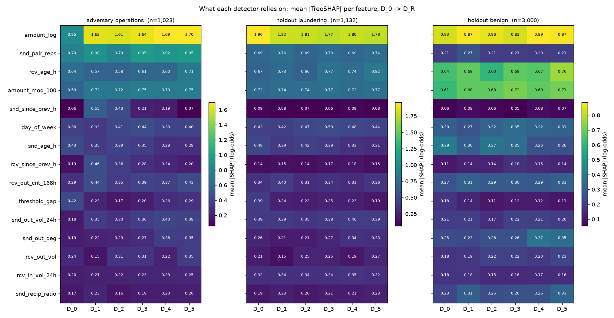
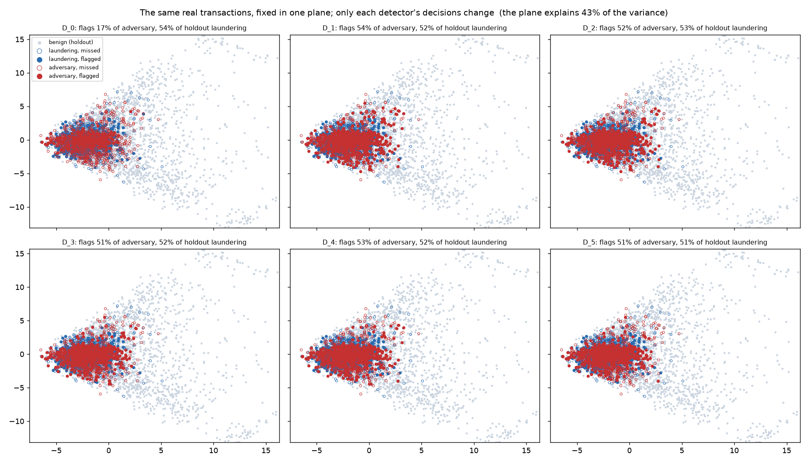

# Phase 4 — Inside the arms race

**Objective 5:** visualise each round's transaction flow, the adversary's evolved strategy, and the
detector's shifting decision boundary.

Everything here is computed from a finished Phase 3 run, without retraining or re-evolving anything:

```bash
uv run python scripts/build_explainability.py     # ~40 s; writes reports/phase4_*
uv run streamlit run dashboard/app.py             # page "Phase 4 — Inside the Arms Race"
```

`src/arena/explain.py` does the computing; `scripts/build_explainability.py` writes
`reports/phase4_explain.json` (273 kB) and two figures; the dashboard page only reads the JSON, so
it works without the trained models on disk.

## Why there is no decision-boundary plot

The synopsis asks for the detector's "shifting decision boundary". The detector decides in a
**74-dimensional** feature space, and any 2-D picture of that boundary has to invent the other 72
coordinates. The usual trick — project to two principal components, lay a grid over the plane, map
the grid back with `inverse_transform`, score it — scores feature vectors that no transaction could
produce (a 74-feature vector reconstructed from two numbers has, for example, a fractional
transaction count and an account age inconsistent with its own history). The contours it draws
belong to the reconstruction, not to the detector. It was not done.

Two views that are true replace it:

1. **What each detector relies on** — attribution drift.
2. **Where its decisions fall on real transactions** — a fixed projection.

Together they answer what a boundary picture is actually asked to show: *what did the detector
learn to trust more, or less, as the adversary pushed on it, and which transactions changed side?*

## 1. Transaction flows

Each round's champion strategy, decoded on four held-out laundering tasks from the evaluation
period, drawn as the transfers it actually makes (source left, destination right, column = hop
depth, edge width = value). The same transfers are scored by two detectors: **D_r**, the one the
strategy was evolved to beat, and **D_(r+1)**, the one retrained on it. Switching between them shows
one round's lesson directly. For example, operation #1 of A_0 has 0% of its value flagged by D_0
and 54% by D_1.

`flow_layout` places the destination strictly to the right of every other account. The first
version did not: a mule at the same hop depth as the destination was drawn in the destination's
column. `tests/test_explain.py` caught it.

## 2. Attribution drift

For every detector D_0 … D_5, the mean absolute **TreeSHAP** contribution of each feature, in
log-odds, on three fixed sets: 1,023 adversary transactions (every champion on 40 evaluation-period
episodes), all 1,132 clean-holdout laundering rows, and 3,000 holdout benign rows. LightGBM computes
exact TreeSHAP natively (`pred_contrib=True`), so a transaction's contributions sum to its raw score
exactly; `tests/test_explain.py` checks that identity rather than trusting it.



On the adversary's operations, from D_0 to D_5:

| feature | D_0 | D_5 | reading |
|---|---:|---:|---|
| `amount_log` | 0.850 | 1.698 | roughly doubles: the single-large-transfer family is now suspicious by size |
| `snd_out_vol_24h` | 0.176 | 0.376 | sender's outgoing value in the last day |
| `snd_pair_reps` | 0.787 | 0.953 | new counterparties |
| `snd_out_deg` | 0.188 | 0.350 | fan-out from the sender |
| `amount_mod_100` | 0.593 | 0.746 | **the generator's round-number artefact**, leaned on harder — see below |
| `snd_age_h` | 0.435 | 0.277 | account age loses weight: the adversary learned to use mature accounts |
| `threshold_gap` | 0.421 | 0.295 | distance from $10k loses weight: the adversary moved away from the threshold |

`snd_since_prev_h` spikes at D_1 (0.06 → 0.55) and falls back to 0.07 by D_5: a lesson specific to
A_0's timing that later rounds made irrelevant.

**`amount_mod_100` rising is not a discovery.** Synthetic laundering is never a round number while
21.6% of benign traffic is (`docs/phase1.md`, "A fourth artefact"). Retraining on adversary rows,
whose amounts are cent-precise, reinforces "not round means suspicious". The view is doing its job
by showing it. Phase 5 confirms the artefact is synthetic-only: in the IBM data, round $100 amounts
are 0.013% of benign and 0.022% of laundering.

## 3. Fixed projection

The same real transactions — 3,000 holdout benign, 1,132 holdout laundering, 1,023 adversary — are
placed once in a two-component PCA plane fitted on the holdout and never refitted. Each panel
colours them by one detector's decision. The points never move; only the decisions do.



| detector | adversary flagged | holdout laundering flagged | holdout benign flagged |
|---|---:|---:|---:|
| D_0 | 17.4% | 53.7% | 0.20% |
| D_1 | 54.5% | 51.9% | 0.33% |
| D_2 | 51.9% | 52.9% | 0.33% |
| D_3 | 51.1% | 51.6% | 0.27% |
| D_4 | 52.7% | 52.3% | 0.30% |
| D_5 | 51.2% | 51.1% | 0.27% |

From D_0 to D_1 most of the adversary's missed transactions become flagged while clean laundering
barely changes: the detector learned the adversary without forgetting the original typologies.
After D_1 the picture hardly moves, which is the plateau the Phase 3 cross-play matrix shows.

**The first version of this plane was wrong.** It standardised the features and reported "50% of
the variance explained" — but what it explained was a handful of benign hub accounts with volumes
four orders of magnitude above the rest, which defined both axes and crushed every laundering and
adversary point into one corner. Standardising rescales a heavy tail; it does not shorten it. Each
feature now goes through a signed `log1p` first. The plane explains less (42.6%: 22.6% + 20.0%) and
shows more. The axes are also framed on the laundering and adversary points, so a few far benign
transactions fall outside the frame by design. `tests/test_explain.py` pins the fix: a single 1e9
outlier must not define the plane.

The plane explains under half the variance and laundering overlaps heavily with benign traffic in
it. That is expected: if two linear components could separate laundering, the detector would not
need 74 features. Read it as a map of where the decisions fall, not as the model.

## Tests

`tests/test_explain.py` (9 tests): SHAP contributions sum to the raw score; attribution shapes and
the drift column; the projection is deterministic and position-independent of grouping; a single
outlier cannot define the plane; the flow layout puts the source first and the destination strictly
last; decoded flows are scored by both judges.

## Limitations

- The flows are four episodes per round, chosen by a fixed seed — illustrations, not statistics. The
  statistics are in Phase 3's 200-episode re-evaluation.
- Attribution says what the model uses, not what is causally true about laundering.
- "Live transaction flows" is replay of decoded operations, not a live feed.
