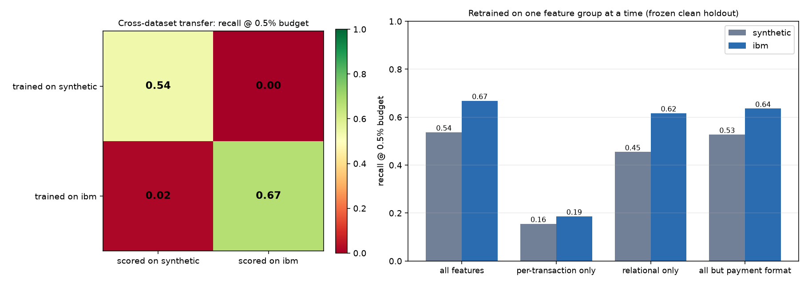

# Phase 5 — Real data: the IBM AML benchmark

The synopsis asks for the detector to be trained on the IBM AML dataset (objective 1) and validated
on PaySim. Phases 1-4 were built synthetic-first, with the IBM reader written but unexercised. This
phase runs the **unchanged** Phase 1-3 pipeline on the real IBM data and asks what survives the move.

## The data

[IBM Transactions for Anti Money Laundering](https://www.kaggle.com/datasets/ealtman2019/ibm-transactions-for-anti-money-laundering)
(Altman et al., 2023), variant **HI-Small**: `HI-Small_Trans.csv` (5,078,345 transactions) and
`HI-Small_Patterns.txt` (370 labelled laundering attempts). It is the standard public benchmark for
transaction-level AML. It is **itself simulated** — produced by IBM's AMLworld multi-agent
generator, because real bank data with laundering labels cannot be published — but it was built
independently of this project, by people who were not trying to make our detector look good. That
independence is what this phase tests.

### Running it

The Phase 1-3 scripts are not copied or modified for real data. A config overlay points them at it:

```bash
uv run python scripts/prepare_ibm.py               # with ARENA_CONFIG=config/ibm.yaml set
ARENA_CONFIG=config/ibm.yaml uv run python scripts/train_detector.py
ARENA_CONFIG=config/ibm.yaml uv run python scripts/evolve_adversary.py
ARENA_CONFIG=config/ibm.yaml uv run python scripts/run_arena.py
uv run python scripts/phase5_transfer.py            # synthetic <-> IBM transfer, ablations
```

`config/ibm.yaml` changes only what the data forces: file locations (`reports/ibm/`,
`artifacts/ibm/`) and the episode deadline (24 hours, because HI-Small has ten live days; see below).
Every model, threshold, GA and feedback-loop setting is shared with the synthetic runs.

### What profiling found before training

Each of these would have produced a wrong number had the data gone straight into training.

| finding | consequence if ignored | what was done |
|---|---|---|
| Background traffic stops on 10 Sep, but laundering keeps completing for 8 more days: 715 rows, 652 of them laundering | the chronological holdout sits on that tail, and "late timestamp = laundering" scores brilliantly while meaning nothing | days below 1% of median daily volume are cut (`tail_cut_at` 2022-09-11) |
| 11.6% of rows (591,212) are self-transfers, 11 of them laundering | the schema rejects them: a transfer with no counterparty is not something an adversary can hide behind | dropped, counted |
| only 2,546 of 4,514 kept positives match a pattern in the patterns file | the loader labelled the rest "stack", silently corrupting per-typology recall | they are now `unattributed` |
| amounts are in each row's own currency (15 currencies); 98% of accounts use one | see the adversary section | — |

After cleaning: **4,486,418 transactions, 4,514 laundering (0.101%), 422,648 accounts, 10 days.**
All counts are in `reports/ibm/phase5_data.json`, written by the loader rather than copied by hand.

The project's best-known synthetic artefact is absent here: round $100 amounts are 0.013% of IBM
benign traffic and 0.022% of IBM laundering, against 21.6% and 0% in the synthetic generator. A
different shortcut takes its place: **88% of IBM laundering is paid by ACH, against 12% of benign
traffic.**

## 1. The detector on real data

The Phase 1 script, unchanged, on the same chronological 60/15/25 split:

| | synthetic (Phase 1) | **IBM HI-Small** |
|---|---:|---:|
| holdout transactions | 500,001 | 1,121,605 |
| holdout laundering | 1,132 (0.23%) | 1,324 (0.12%) |
| **recall @ 0.5% alert budget** | 0.537 | **0.668** |
| PR-AUC | 0.454 | 0.424 |
| precision @ budget | 0.243 | 0.158 |
| ROC-AUC (misleading at this prevalence) | 0.971 | 0.983 |
| Phase 1 gate (PR-AUC ≥ 0.40, recall ≥ 0.50) | PASS | PASS |

Chance PR-AUC at IBM's prevalence is 0.0012, so 0.424 is 360× chance. Per typology:

| typology | synthetic | IBM |
|---|---:|---:|
| fan-out | 0.41 | 0.91 |
| fan-in | 0.41 | 0.95 |
| cycle | 0.48 | 0.94 |
| gather-scatter | 0.46 | 0.96 |
| stack | 0.75 | 0.86 |
| unattributed (IBM only) | — | 0.26 |

The patterned typologies are caught at 0.86-0.96 and the 44% of positives the patterns file does not
list at 0.26, so the headline recall is an average over two very different populations. On the
project's own rule — *a suspiciously good score is a bug until shown otherwise* — the 0.9+ figures
were checked against what the model uses. The top attributions are `snd_pair_reps` (benign senders
repeat a counterparty a median 14 times, laundering pays new counterparties), `format_code` (36% of
the model's gain: the ACH shortcut), burst ratio and account age. These are properties of the IBM
data, not of our pipeline — but the ACH one is a property of IBM's *simulator*, and the adversary
below finds it.

## 2. Nothing transfers between the two worlds

`scripts/phase5_transfer.py` scores each detector on the other dataset's frozen clean holdout, with
the same alert-budget policy applied to the target's own traffic.



| recall @ budget / PR-AUC | scored on synthetic | scored on IBM |
|---|---:|---:|
| trained on synthetic | 0.537 / 0.454 | **0.000 / 0.001** |
| trained on IBM | **0.016 / 0.003** | 0.668 / 0.424 |

Chance recall at a 0.5% budget is about 0.005. Each detector learned its own world's laundering and
nothing general enough to recognise the other's. This is the strongest evidence in the project for
the limitation stated since Phase 1: **synthetic numbers are a pipeline check, not a result.** It
also says the synthetic generator's typologies, though named like IBM's, are not shaped like them.

## 3. PaySim, and what a graph-free check would keep

The synopsis names PaySim as a secondary validation set. It was not used: PaySim has no account graph
comparable to IBM's and no typology labels, so 57 of the detector's 74 features cannot be computed
on it. The question PaySim would answer — *how far does the per-transaction signal alone get?* — can
be answered directly, by retraining on one feature group at a time:

| recall @ budget / PR-AUC | synthetic | IBM |
|---|---:|---:|
| all 74 features | 0.537 / 0.449 | 0.668 / 0.424 |
| per-transaction only (17) | 0.155 / 0.023 | 0.187 / 0.019 |
| relational only (57) | 0.455 / 0.366 | 0.617 / 0.290 |
| all but payment format (72) | 0.527 / 0.444 | 0.636 / 0.351 |

On both datasets the per-transaction features keep under a third of the recall and about 5% of the
PR-AUC. A PaySim validation would therefore have measured mostly the part of the detector that does
not matter. The account graph carries the detection — which is also why invariant 1 (one
`featurize()`, through the overlay) matters so much for the adversary.

The last row matters for the next section. Without payment format the IBM detector loses only 3
points of recall on IBM's own laundering: it does not *need* format. But given format, it uses it.

## 4. The adversary and the arms race on IBM data

**Phase 2 on IBM (corrected decoder).** The GA reaches fitness 1.000 — but so does the hand-written
naive strategy (0.998). Detector recall on the naive strategy is **0.000**, on random genomes 0.006,
on the evolved champion 0.000. The Phase 2 gate (which expects the naive strategy to be caught) **fails**
on IBM, and is recorded as failed rather than moved: there is nothing for evolution to improve on.

**Why: one dataset shortcut.** 88% of IBM laundering is paid by ACH against 12% of benign traffic, and
the IBM detector uses it (36% of its gain). Re-scoring the naive strategy's transfers with only the
payment format changed to ACH lifts the median detector score from 0.0006 to 0.62. Retraining the
detector without the two format features (`scripts/phase5_shortcut.py`, 60 held-out episodes):

| strategy | D_0 recall / adversary wins | D_0 without format |
|---|---:|---:|
| naive | 0.000 / 100% | 0.167 / 100% |
| naive, paid by ACH | 0.144 / 100% | 0.167 / 100% |
| Phase 2 champion | 0.000 / 100% | **0.233 / 78%** |
| clean IBM holdout recall (PR-AUC) | 0.668 (0.424) | 0.636 (0.351) |

Removing the shortcut costs 3 points of recall on IBM's own laundering and makes the detector
measurably harder to evade, but it is still evaded in most episodes.

**The closed loop on IBM** (5 rounds, 30 held-out episodes per cell, same settings as the synthetic run):

| round | clean-holdout recall / PR-AUC | D_r recall vs A_r | adversary success |
|---:|---:|---:|---:|
| 0 | 0.668 / 0.424 | 0.000 | 100% |
| 1 | 0.660 / 0.420 | 0.200 | 80% |
| 2 | 0.664 / 0.390 | 0.067 | 93% |
| 3 | 0.657 / 0.407 | 0.125 | 100% |
| 4 | 0.668 / 0.399 | 0.033 | 97% |
| final D_5 | 0.669 / 0.382 | — | — |

The loop's guards held (holdout unchanged, alert budget exact every round, feedback within its 20% cap;
the Phase 3 gate passes). But **feedback did not help here.** Each retrained detector learns the
strategy it was shown (cross-play: D_1 recall 0.60 against A_0) and then loses to the next, which finds
another way through; clean-holdout PR-AUC falls from 0.424 to 0.382. On synthetic data the same loop
raised recall against the contemporary adversary from 0.125 to 0.510; on IBM it stays between 0.00 and
0.20. With only 30 episodes per cell and one seed these are indicative, not tight, but the direction is
not in doubt. A detector that leans on a dataset shortcut cannot be repaired by patching individual
strategies.

### What went wrong first

The first IBM adversary run reported evasion 1.000 and a completion of **525× the goal**. The decoded
transactions showed three holes in the simulation, not a strategy: chained USD→Yen conversions created
money (IBM amounts are in each row's own currency); one account's tranches were paid in five currencies
within minutes (98% of IBM accounts use one currency); and the decoder used *Reinvestment* between two
accounts, a format IBM only has as a self-transfer, so the detector had never seen it. `RealWorld` in
`decoder.py` now restricts a real-data operation to one currency and to the accounts and formats the
ledger itself uses, and `tests/test_ibm.py` decodes 300 random genomes on that path and checks money is
conserved. Two performance fixes were also needed for IBM's 422,648 accounts (layered rather than copied
overlays; single-threaded scoring of small batches); invariant 1's overlay-equivalence test still passes.

## Limits of this phase

IBM's data is itself simulated (AMLworld); 88% of its laundering being ACH is a property of that
simulator. The IBM arms race is one seed and 30 episodes per cell. PaySim was not used. The synthetic
generator's round-number artefact was not fixed: Phase 1's score was good rather than suspect, and the
artefact is absent in IBM data.

